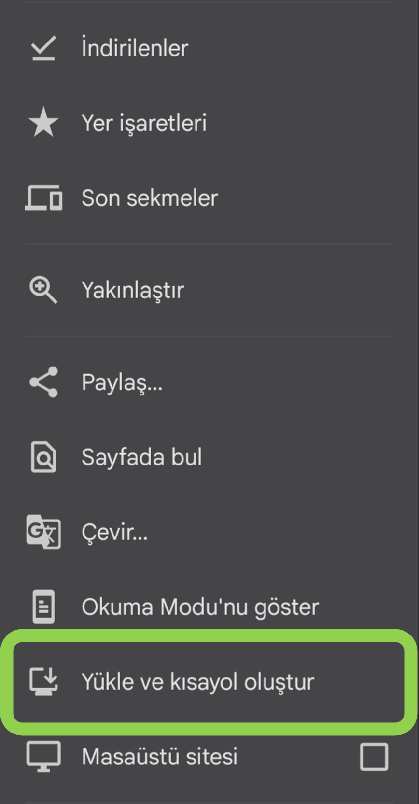
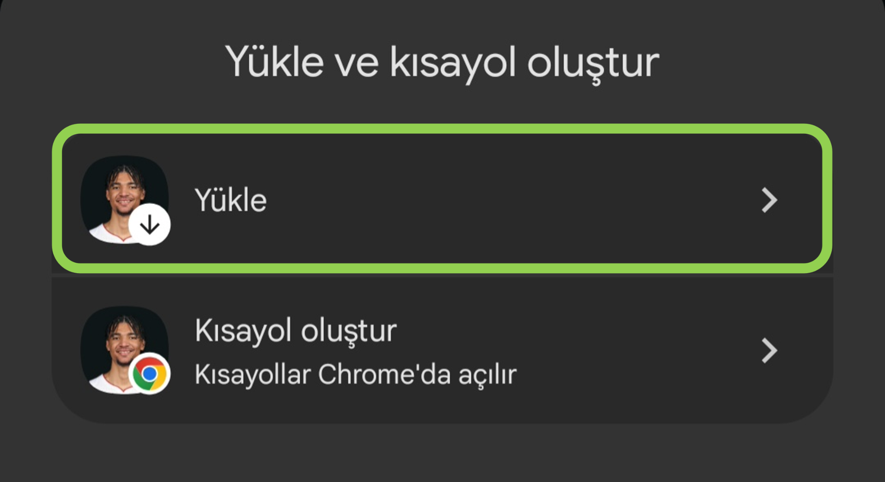
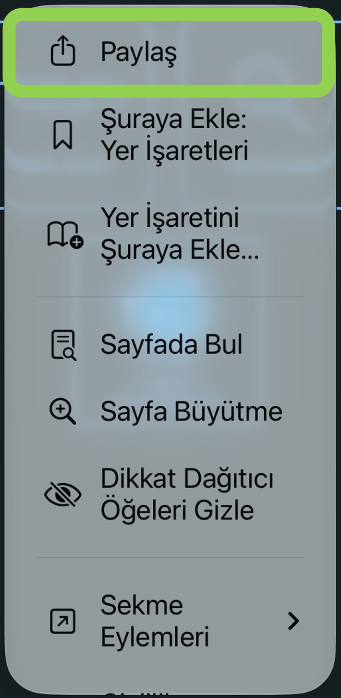
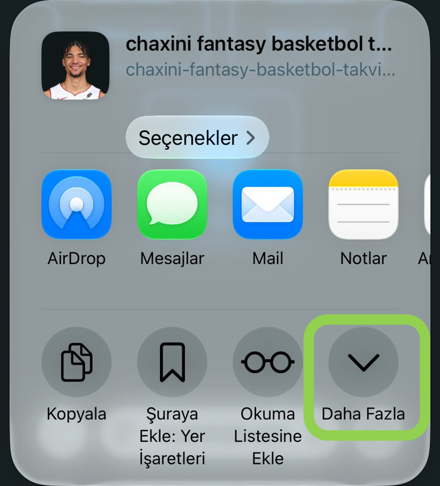
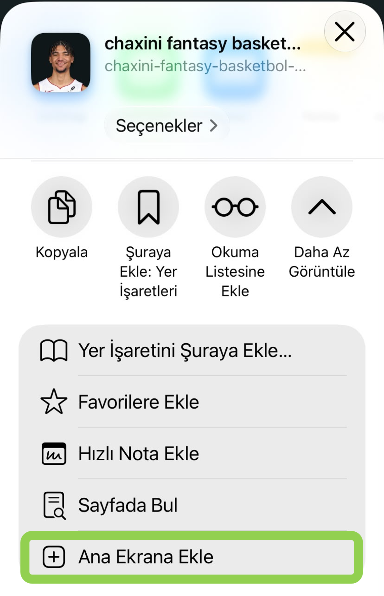

# Chaxini · Fantasy Basketbol Takvimi

Chaxini, NBA fantasy basketbolunda haftalık kadro planlamak için geliştirilmiş bir web uygulaması. NBA takımlarının maç programını, Yahoo Fantasy ligindeki kadroları ve oyuncu istatistiklerini bir araya getiriyor. Böylece bir oyuncunun ortalamalarına bakarken bu hafta kaç maçı kaldığını, hangi günlerde kadroya sığabileceğini ve yapacağın değişikliğin eşleşmeye nasıl yansıyabileceğini de görebiliyorsun.

## Uygulamanın bölümleri

### Sezon özeti

Her NBA takımı için hafta hafta kaç maç olduğunu gösterir. İçinde bulunduğumuz hafta tabloda vurgulanır. Birkaç haftayı yan yana karşılaştırıp hangi takımların programının sıklaştığını veya seyrekleştiğini görebilirsin. Özellikle oyuncu alıp bırakmayı bir haftadan daha uzun vadeli düşündüğünde işe yarar.

### Haftalık takvim

Seçtiğin haftanın maçlarını gün gün gösterir. Takım satırını açtığında rakipleri ve maçların iç sahada mı deplasmanda mı olduğunu görebilirsin. Kalan maç sayısı seçtiğin tarihe göre hesaplanır. İstersen o tarihi de kalan maçlara katabilir, takımları haftalık toplam veya kalan maç sayısına göre sıralayabilirsin. Takım araması ve favori filtresiyle tabloyu takip ettiğin takımlara daraltabilirsin.

### Fikstür analizi

Seçtiğin haftada hangi takımların **art arda iki gün** veya **dört gün içinde üç maç** oynadığını gösterir. Seriler, başladıkları haftada yer alır. Örneğin pazar günü başlayıp pazartesi devam eden iki maçlık seriyi pazarın bulunduğu haftada görürsün. Bu ekran, birkaç gün içinde birden fazla maç yapacak bir oyuncuyu kısa süreliğine kadroya katmak istediğinde aday takımları belirlemene yardımcı olur.

### Takım analizi

Herkese açık bir Yahoo Fantasy NBA lig bağlantısı girip **Ligi yükle / yenile** düğmesine bastığında Chaxini, ligdeki takımları, kadroları ve oyuncu istatistiklerini Yahoo’dan alır. Kadro kayıtları ve istatistikler oyuncu kimliğiyle eşleştirilir. Takımını seçtikten sonra kendi kadronu, boştaki oyuncuları veya tüm oyuncu havuzunu inceleyebilirsin.

- **Oyuncu tablosu.** Boştaki oyuncular görünümüne hem serbest oyuncular (FA) hem de waiver sürecindeki oyuncular (W) girer. Tabloda ortalama süresi en az 10 dakika olan oyuncular yer alır ve NA durumundakiler elenir. Oyuncu adı, NBA takımı veya pozisyonuyla arama yapabilirsin. Sayı, üçlük, ribaund, asist, top çalma, blok, dakika veya şut yüzdesi seçildiğinde yüksek değerler önce gelir. Top kaybında düşük değerler, Yahoo sıralamasında ise daha iyi sıradaki oyuncular öne çıkar.
- **Maç başı ortalamalar.** Sezon toplamı bulunan istatistikler oyuncunun kendi oynadığı maç sayısına bölünür. Oyuncunun oynamadığı maçlar ortalamaya sıfır olarak girmez. Katılım oranı ise ayrı hesaplanır. Bunun için oyuncunun oynadığı maç sayısı NBA takımının tamamladığı maç sayısına bölünür.
- **Takım takviyesi.** Bir veya birden fazla kategori seçtiğinde uygulama uygun oyunculardan en fazla 10 öneri çıkarır. Ortalama 10 dakika koşuluna ek olarak oyuncunun takım maçlarının en az **%45’inde** oynamış olması ve pozisyonu ile Yahoo sırasının biliniyor olması gerekir. Oynayamayacak durumdaki oyuncular öneri havuzundan çıkarılır. Serbest oyuncular varsayılan olarak değerlendirilir. Waiver oyuncularını dilersen ayrıca dahil edebilirsin.

Öneri sırası, adayların seçtiğin kategorilerde birbirlerine göre ne kadar iyi olduğuna dayanır. Kategori katkısı puanın ana bileşenidir. Yahoo sırası ve katılım oranı da daha düşük ağırlıkla hesaba girer. Durumu belirsiz (Q/GTD) oyuncuların puanı düşürülür. FG% ve FT% değerlendirmesinde hem isabet oranına hem de atış hacmine bakılır. Örneğin yüksek yüzdeyle az atış kullanan bir oyuncunun kadronun yüzdesine etkisi sınırlı kalabilir.

### Takım verimlileştirme

Bu sayfa, **kalan maçlar oynandığında Yahoo eşleşmesi nasıl şekillenebilir ve tek bir oyuncu değişikliği sonucu etkileyebilir mi?** sorusuna bakar.

1. **Günlük kadroları eşleştirir.** Seçtiğin tarihten haftanın sonuna kadar senin ve rakibinin Yahoo’daki günlük kadroları kullanılır. Henüz başlamamış maçlardan aktif pozisyona atanmış oyuncular tahmine girer. Yedekler ayrı sayılır. Sakatlık yuvalarındaki ve oynayamayacak durumdaki oyuncular hesap dışında kalır.
2. **Dokuz kategoriyi karşılaştırır.** Aktif oyuncuların maç başı ortalamaları, kalan her maç için toplanır. FG% ve FT%, tahmini toplam isabetlerin toplam denemelere bölünmesiyle bulunur. Sayı, üçlük, ribaund, asist, top çalma, blok ve şut yüzdelerinde yüksek değer, top kaybında ise düşük değer avantaj sağlar. Tablo, iki takımın tahmini toplamlarını ve kategori skorunu gösterir.
3. **Yakın kategorilerde oyuncu değişikliği dener.** Geride veya berabere olduğun kategorilerde iki takım arasındaki farkın, iki tahmini değerin toplamına oranı **%3,5’i aşmıyorsa** kategori değişiklik için değerlendirilir. Uygulama, kadrodan bir oyuncu çıkarıp uygun bir serbest oyuncu eklemeyi dener. Yeni oyuncunun kalan maçlarından yalnızca boş ve pozisyonuna uygun bir yuvaya sığanlar hesaba katılır. **Koru** işaretli oyuncular ile Yahoo güncel sıralamasında ilk 75 veya sezon öncesi sıralamasında ilk 50 içindeki oyuncular çıkarma adayı olmaz.
4. **Kategori sonucunu çevirebilen seçenekleri gösterir.** Bir değişiklik ancak seçilen kategoriyi tahminde galibiyete çeviriyorsa listelenir. Seçenekler önce dokuz kategorideki genel galibiyet ve mağlubiyet farkına, sonra seçilen kategoride açtıkları farka göre sıralanır. Koşulu sağlayan değişiklik bulunmazsa liste boş kalabilir.

Bu hesaplar sezon ortalamalarına dayalı tahminlerdir. Oyuncu ekleme veya çıkarma işlemini Yahoo’da sen yaparsın.

## Canlı uygulama

**[Chaxini uygulamasını aç](https://chaxini-fantasy-basketbol-takvim.onrender.com)**

## Telefona ekleme

Yukarıdaki bağlantıyı telefonunda aç. Kurulum tamamlandığında Chaxini’ye ana ekrandaki simgesinden ulaşabilirsin.

### Android · Google Chrome

<table>
  <thead>
    <tr>
      <th>1. Chrome menüsünü aç</th>
      <th>2. Yüklemeyi tamamla</th>
    </tr>
  </thead>
  <tbody>
    <tr>
      <td valign="top">Chaxini Chrome’da açıkken üç nokta menüsüne dokun. <strong>Yükle ve kısayol oluştur</strong> seçeneğini seç.</td>
      <td valign="top"><strong>Yükle</strong> seçeneğine dokun. Onay ekranı çıkarsa yüklemeyi onayla.</td>
    </tr>
    <tr>
      <td align="center" valign="top"></td>
      <td align="center" valign="top"></td>
    </tr>
  </tbody>
</table>

### iPhone · Safari

<table>
  <thead>
    <tr>
      <th>1. Paylaş menüsünü aç</th>
      <th>2. Seçenekleri genişlet</th>
      <th>3. Ana ekrana ekle</th>
    </tr>
  </thead>
  <tbody>
    <tr>
      <td valign="top">Chaxini’yi Safari’de aç. Sayfa menüsünden <strong>Paylaş</strong> seçeneğine dokun.</td>
      <td valign="top">Paylaşım ekranında <strong>Daha Fazla</strong> düğmesine dokun.</td>
      <td valign="top"><strong>Ana Ekrana Ekle</strong> seçeneğini seç. Varsa <strong>Web Uygulaması Olarak Aç</strong> ayarını etkinleştir, ardından <strong>Ekle</strong> düğmesine dokun.</td>
    </tr>
    <tr>
      <td align="center" valign="top"></td>
      <td align="center" valign="top"></td>
      <td align="center" valign="top"></td>
    </tr>
  </tbody>
</table>

